# Bouldering Beta Buddy

Climbers film their attempts constantly and almost never learn anything from
the footage, because watching yourself climb mostly confirms what you already
felt. This turns a climbing video into feedback attached to the second it
applies to. At 0:20 you paused for eleven seconds and then reached with your
arms already bent, when setting a foot first would have let you keep moving.

It is a React Native app with a Python analysis pipeline behind it. Pose
estimation reads the body out of the video, geometry turns the body into
climbing measurements, and a language model turns the measurements into
coaching. **The model never sees the footage**, which is the decision
everything else here follows from.

### Why it exists

CS185 at UC Santa Barbara set a theme rather than a brief, which was to build
an application around AI. I climb, so I went looking for something in climbing
that an AI could genuinely help with, rather than something that would merely
demonstrate one. The gap was obvious once I looked for it.

Three of us designed it for the course. When the quarter ended I kept going
alone, because the interesting half had not been built. The design assumed an
analysis existed and nobody had checked whether it could.

---

## What it does today

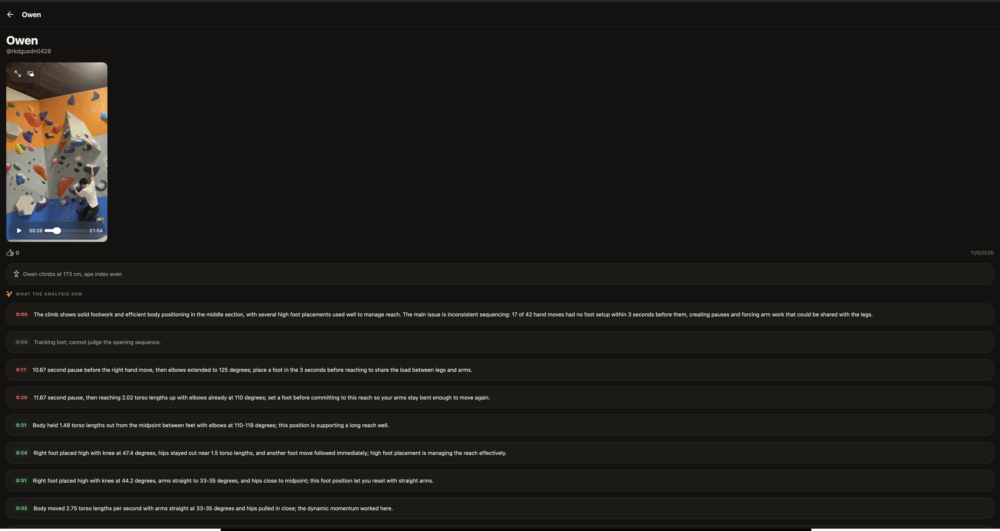

Tapping a note moves the player to that second. The colour says whether it is
something done well, something to change, or a stretch the analysis could not
see.

```
0:00  The climb shows solid footwork and efficient body positioning in
      the middle section, with several high foot placements used well to
      manage reach. The main issue is inconsistent sequencing: 17 of 42
      hand moves had no foot setup within 3 seconds before them,
      creating pauses and forcing arm work that could be shared with
      the legs.                                                [work_on]

0:06  Tracking lost; cannot judge the opening sequence.            [info]

0:20  11.67 second pause, then reaching 2.02 torso lengths up with
      elbows already at 110 degrees; set a foot before committing to
      this reach so your arms stay bent enough to move again.   [work_on]

0:31  Right foot placed high with knee at 44.2 degrees, arms straight to
      33-35 degrees, and hips close to midpoint; this foot position let
      you reset with straight arms.                                [good]
```

Four lines, and most of the project is in them. The numbers were measured
rather than described. A note says what a move cost rather than only what it
looked like. A note that cannot be justified says so instead of guessing. And
each one is labelled, because a reader should not have to work out from the
prose whether they are being praised or corrected.

Seven clips have been through the measurement pipeline, six of them produce
notes, and two have been through the language step and are in the app.

Around the analysis, the app does what a climbing logbook does. Find gyms
nearby, record what you climbed, upload video of it, review routes. Three
tabs, Gyms, Sessions and You.

---

## How it works

```
  phone video
       │
       ▼
  MediaPipe BlazePose          33 body points per frame, every 4th frame
       │
       ▼
  features.py                  points → climbing measurements
       │                       reach, pause, elbow and knee angle, body
       │                       speed, hips over feet, limb order
       ▼
  notes.py                     measurements → the moments worth mentioning
       │
       ▼
  write_notes.py               moments → coaching sentences  (Claude Haiku 4.5)
       │
       ▼
  video_analysis               one row per moment
       │
       ▼
  the app                      notes beside the video, each one seekable
```

### The model never sees the video

Handing a clip to a multimodal model and asking for coaching is one API call,
and it fails three ways at once. It invents moves that did not happen. It
cannot place a comment at an exact second, because it is guessing at time. And
it costs real money per video.

So the model is given measurements instead:

```
Climber: 173 cm tall, arm span equal to height (ape index 0).
Climb: 45.1 seconds, 18 hand moves, 17 foot moves.
Hand moves made without a foot move in the 3 seconds before: 7 of 18.

[12]  30.7s  left hand moved 2.5 torso lengths up (long reach starts at 1.2)
             body hanging 1.67 torso lengths to the side of the midpoint
               between your feet  [caveat: assumes a roughly side on camera]
             left hand reached 2.5 torso lengths with no foot move in the
               3.6s before it
             2s before: hips 1.21 out (worst 1.67); elbows down to 40deg;
               moved LH | 2s after: hips 0.86 out (worst 1.17); elbows down
               to 82deg; moved RF, RF | next limb moved 0.2s later
```

It cannot hallucinate a move, because there is no footage to hallucinate from
and nothing in the input it was not handed. Timestamps stay exact, because 30.7
came out of a frame number. A whole climb costs about a thousandth of a
dollar. And a wrong sentence is wrong in one of two places, the measurement or
the prompt, which makes it something to debug rather than something to
apologise for.

The caveats matter as much as the numbers. Wall angle is never measured, and
bent arms are correct on an overhang, so a model told only "elbow at 40
degrees" gives advice that is wrong half the time. Every uncertainty the
measurement layer knows about is passed through, and the model is instructed
not to give advice that depends on what a caveat says is unknown. It obeys,
and three notes on the test clip say the bend cannot be judged without knowing
the wall rather than guessing at it.

### Everything is in torso lengths

No measurement is in pixels. A climber filmed from further away has smaller
pixels and the same body, and a ratio to their own shoulder to hip distance
comes out the same either way. It is also the only reason two climbers'
measurements can be compared at all, and that comparison is the premise the
whole app rests on. Beta from somebody built like you.

---

## How it got here

### The design phase

The course work produced the problem statement, the research, the storyboards,
the wireframes and an interactive Figma prototype, by **Owen Kang, Jiemi Niu
and Yulin Yu**. None of it was code. Needfinding, testing, low fidelity and
medium fidelity, in that order. Interviews with boulderers, then mapping what
they felt at each point of a session, then paper, then the clickable version.

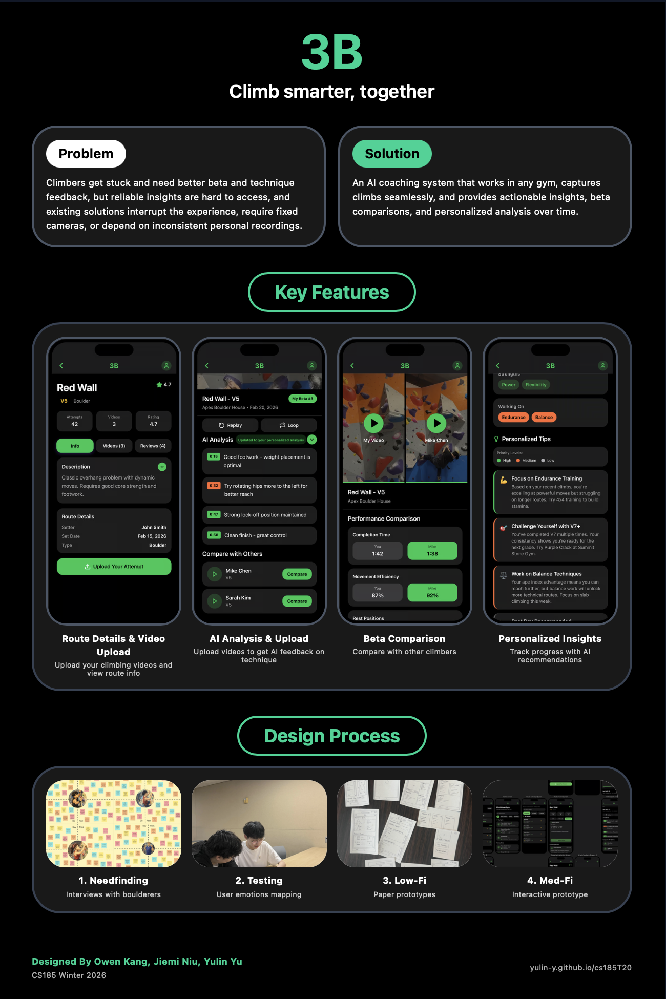

Everything in this repository after that point is a solo implementation. The
design is three people's work and the code is one person's, and the two should
not be confused.

### The capture device was a decision, not a default

Three storyboards, one per device, drawn before anything was chosen.

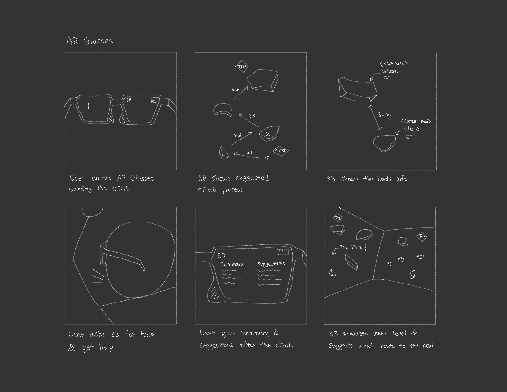

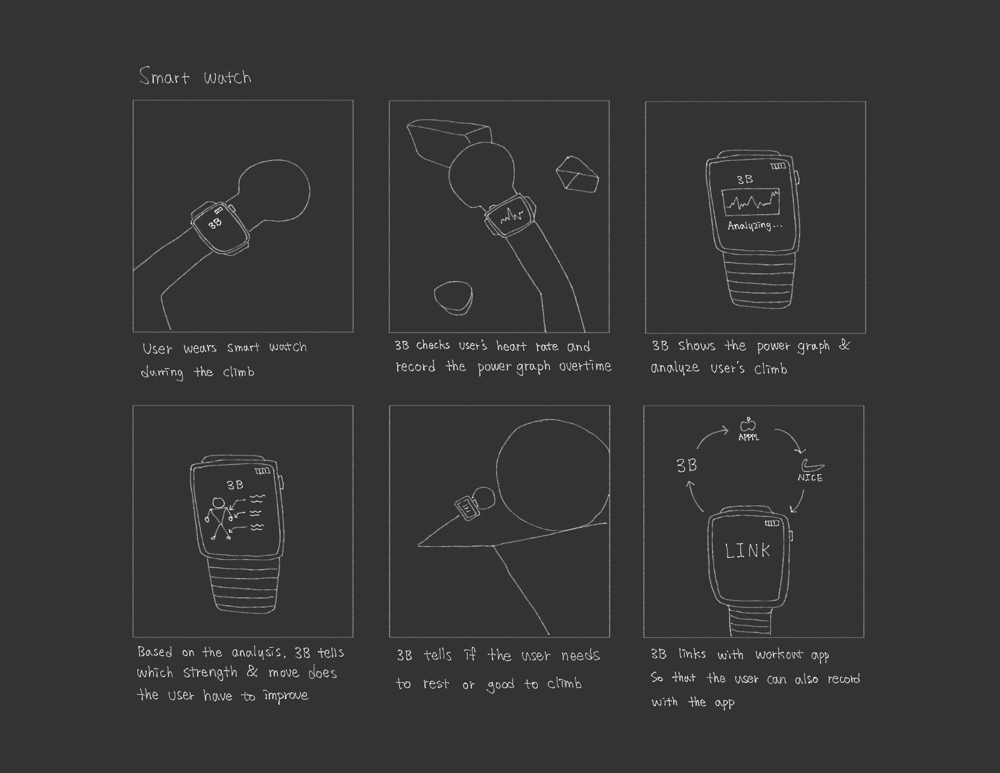

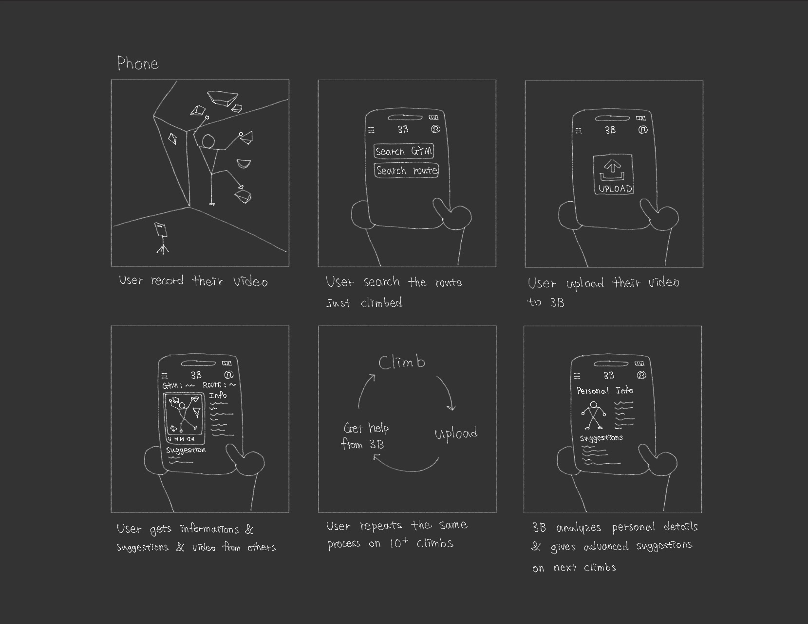

The glasses version is the most appealing one on paper. Holds labelled in your
field of view, the next move highlighted on the wall, help on request mid
climb. It also gives a first person view, which is the wrong view, because you
cannot see your own body and the body is the entire signal here.

The watch version reads heart rate and effort over time and tells you when to
rest. That is a real product. It also knows that you moved and not where to,
so it can say nothing about technique.

The phone version is the least interesting to draw. Film the climb, upload it,
read the analysis, repeat. It gives a third person view of the whole body,
which is exactly what pose estimation needs.

The deciding factor was not technical. **Every climber already films on a
phone.** Hardware nobody owns has no users, however good the data would be.
The phone is worse data from a far better starting point, and that trade
decided the shape of everything after it.

### From paper to screens

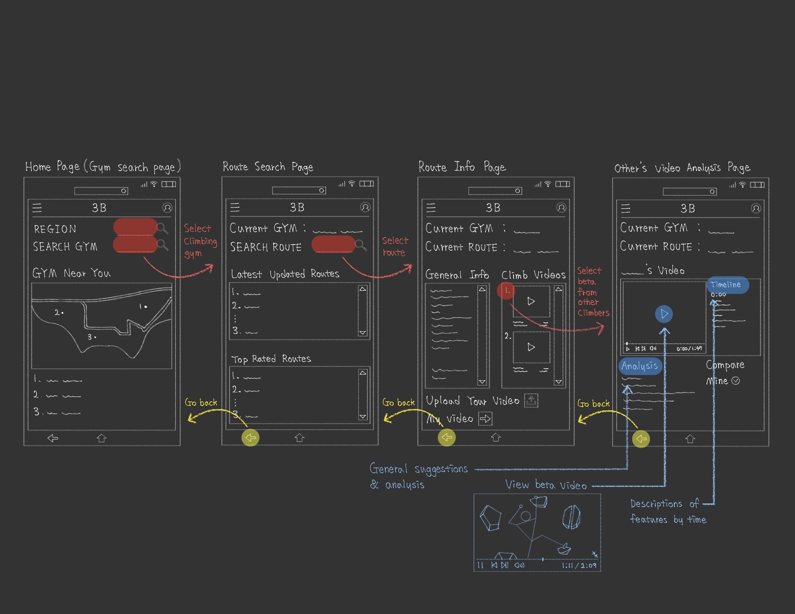

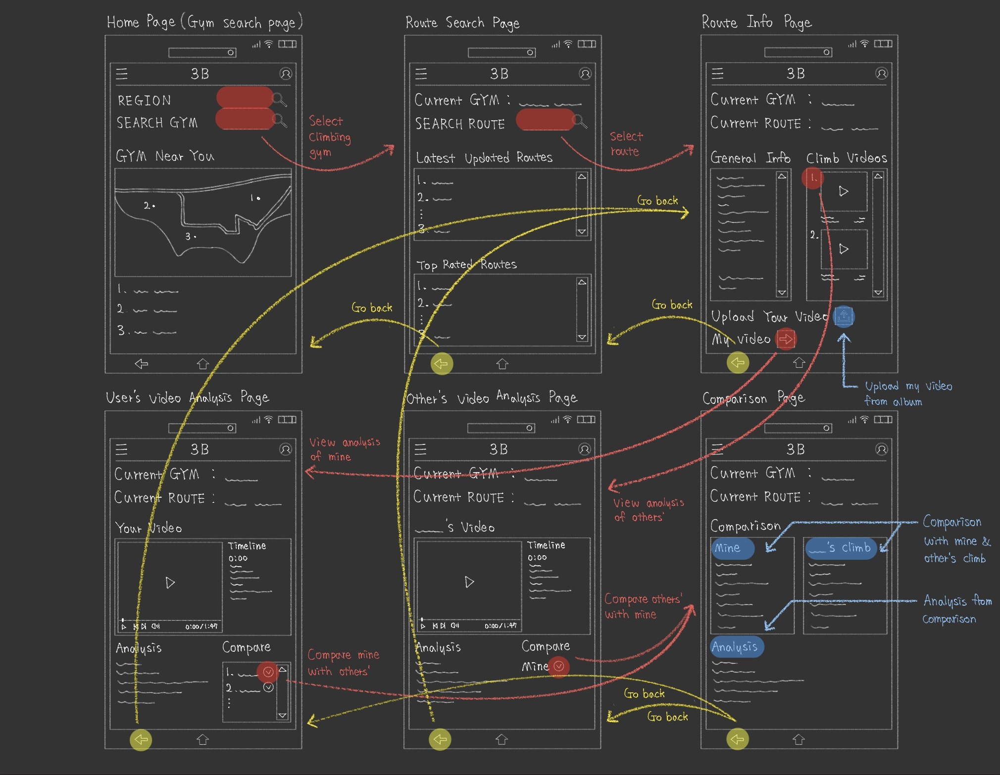

The wireframes are where beta comparison became concrete. Your video and
another climber's on the same route, side by side, each with its own analysis,
and a comparison between them.

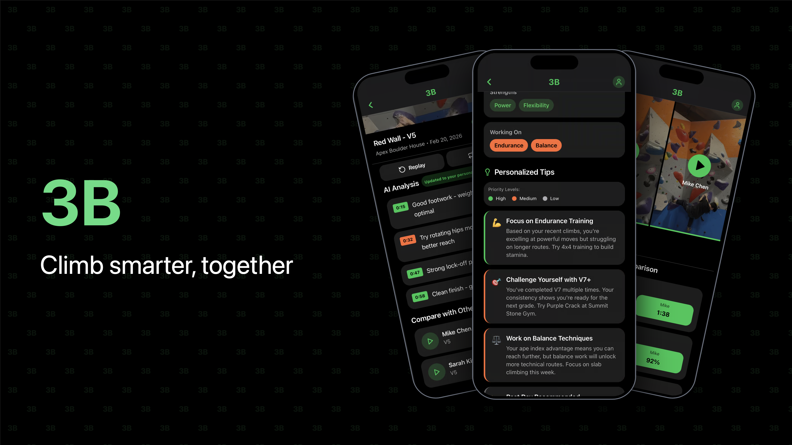

### Then the building started

**The logbook first.** Gyms, routes, sends, reviews, video upload. This is the
part that looks like every other climbing app, and it came first on purpose.
The analysis is only interesting if there is somewhere for a video to live and
something for a note to attach to.

**Then the lab.** `ai-lab/` is a separate Python project with its own virtual
environment, kept out of the app entirely. It exists because "can 33 dots say
anything useful about climbing?" had to be answered before any of it was worth
wiring into a product. The answer took several rewrites.

Most of the lab is tooling for looking at what the measurements did. A page
like this is generated per video, showing the confidence the tracker reported
over time, the measurements plotted against each other, and every detected
move in a table that seeks the footage when a row is clicked.

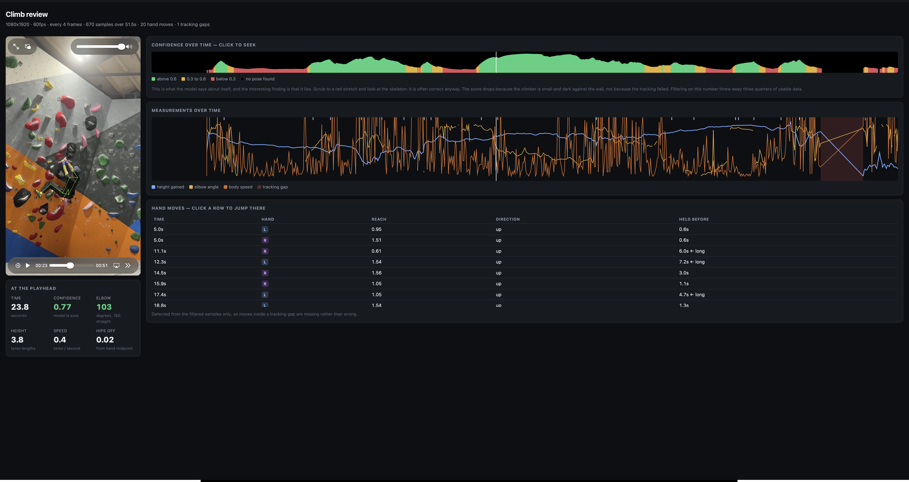

The confidence strip along the top is where the most useful finding came from.
The tracker reports low confidence over long stretches where the skeleton is
in fact correct, which is why `MIN_CONFIDENCE` is 0.3 rather than the 0.6 it
started at. Trusting the model's opinion of its own work threw away three
quarters of usable footage.

**Then the loop.** Video to pose to measurement to note to database to screen,
end to end on real footage. That is the state the repository is in.

### What the prototype promised and what exists

| | | | |
|---|---|---|---|
| 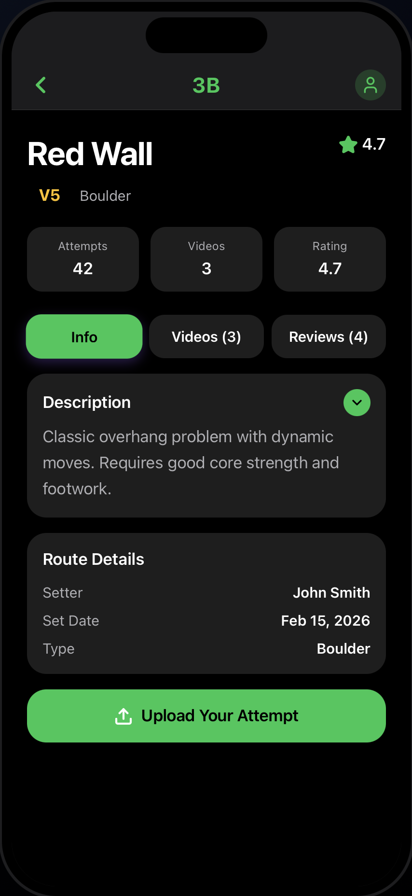 | 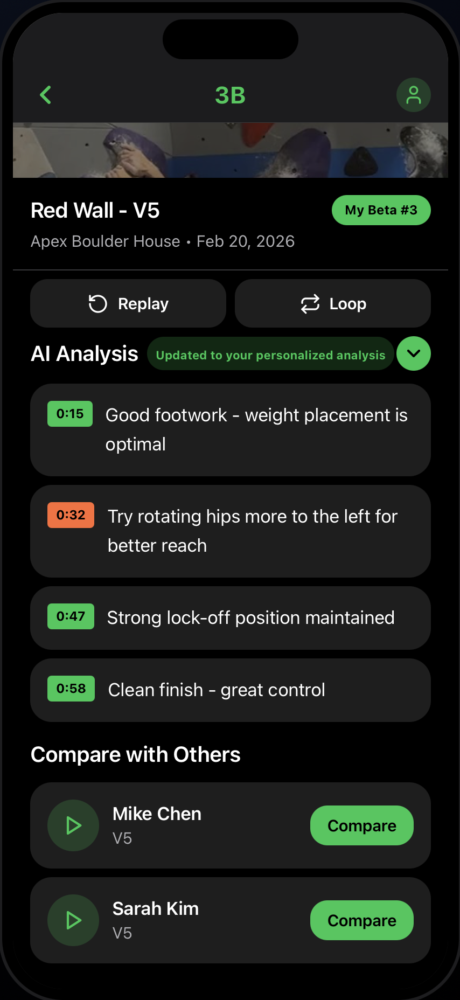 | 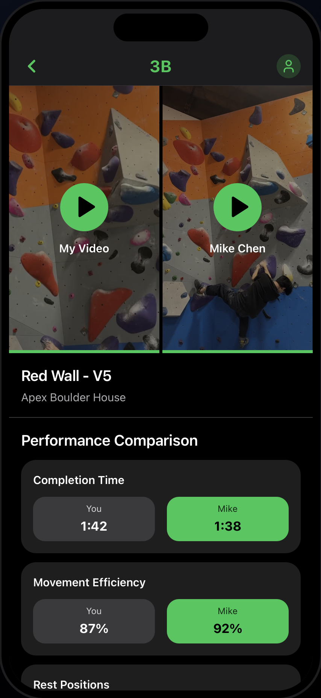 | 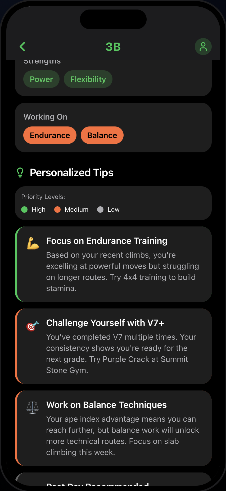 |
| Route and upload | Analysis and compare | Two climbers side by side | Personalised tips |

The prototype was filled with invented data, which is what prototypes are for.
Holding it against the working app is the clearest statement of what got built.

| In the prototype | In the app |
|---|---|
| Route details, videos, reviews, upload | Built |
| AI analysis as timestamped notes down the video | Built, and the notes are measured rather than written by hand |
| Notes colour coded as praise or correction | Built |
| Beta comparison, two climbers side by side | Not built. Nothing identifies which holds were used, so there is nothing to compare except timing |
| Movement efficiency as a percentage | Not built, and not attempted. No definition of efficiency the measurements could support exists, and a number that looks precise and means nothing is worse than no number |
| Personalised insights across many climbs | Not built. It needs a history of climbs and there are seven videos |
| Rest day recommendations | Not built |

The two that matter are beta comparison and insights across climbs, because
those are the product. Everything in this repository is the layer underneath
them. You cannot compare two climbers' beta until you can measure one
climber's movement, and measuring one climber's movement is the part that
turned out to be hard.

---

## What is measured

| | |
|---|---|
| Hand moves | which hand, how far, which direction, how long it had been still |
| Foot moves | separate thresholds, separate confidence gate, and their own ceiling |
| Limb order | whether a foot was set in the seconds before a hand left |
| Elbow angle | with a plausibility floor, because tracking folds arms past where arms fold |
| Knee angle | high steps, with the same floor for the same reason |
| Hips over feet | sideways distance from the centre of mass to the midpoint of the feet |
| Body speed | dynamic against static movement |
| Before and after | the same measurements either side of a moment, which is what makes a move judgeable rather than only describable |
| Tracking gaps | stretches the analysis refuses to talk about |

Every threshold is in `ai-lab/config.py` with a comment saying what it means
and what it looks like when it is wrong. Nothing is a bare number in the
middle of a function.

### What is not measured

**Wall angle.** Nothing in the video says whether this is a slab or an
overhang. Estimating it from body geometry was tried and does not work. The
spread of the estimate came out wider than the estimate itself on every clip,
because a climber's sideways movement dwarfs the wall's lean. The fix is a tap
when a route is added, not computer vision.

**Holds.** Nothing knows where they are, so nothing can say "there was a
better one to the left". Colour segmentation finds roughly a third of them and
fails entirely on a coloured wall, where holds and panel share a saturation.
Doing it properly means a trained detector.

**Load.** A camera sees where a foot is and not what it is carrying, which is
why toe and heel are the same event to this, and why nothing can say whether a
dynamic move was worth the energy it took.

### Tracking is not reliable on all footage

Across seven clips, the share of frames with a usable pose runs from 62% down
to 1%:

```
IMG_1919     62%   1061 frames
climb_kakao  52%    160
IMG_5030     48%    368
IMG_1946     47%    441
IMG_1772     37%    108
IMG_1766     28%    122
IMG_1773      1%      5   produces no notes at all
```

The clip that failed completely has the largest body in frame of any of them,
which rules out the obvious explanation. It is unresolved.

**And nothing has been validated.** There is no accuracy figure for move
detection, because nobody has sat down with the footage and marked which
detected moves were real. Until that exists, "it works" is an impression
rather than a measurement, and this README will not claim otherwise.

---

## Where it stands

This is not a product. It has one user, no validation, and a pipeline that
runs on a laptop rather than a server, so a video uploaded from the app is not
analysed until somebody runs the Python by hand. The distance between that and
something other people could use is longer than the distance already covered.

What is true is smaller and worth saying anyway. **Running it on my own
climbing has already been mildly useful, and the useful parts are not the ones
I expected.**

**What works.** Where the weight sits, and which limb should move first. Both
are simple, both are measured rather than guessed, and the suggestions that
come out of them are ones I can act on at the wall. That 17 of 42 hand moves
on one climb had no foot placed in the three seconds before them is not
something anybody notices watching themselves climb.

**Where it stops working.** Anything steep. This is the unmeasured wall angle
seen from the other side, and it is worse than it first looks. The problem is
not only that bent arms cannot be judged. Most of the advice quietly assumes a
wall close to vertical.

**What is missing.**

*Toe and heel are one thing to this.* A foot move is a foot move. In climbing
they are different moves for different reasons, and footwork feedback that
cannot tell a heel hook from a toe hook covers half of footwork. Both
keypoints are tracked. What is missing is which one is loaded.

*Without a power meter, dynamic and static cannot be compared.* The analysis
can say a move was fast. It cannot say whether fast was the right call,
because what decides that is the effort it took, and nothing here measures
effort.

*And without that, no training.* The obvious next thing is a routine built
from what the measurements say a climber is weak at. That needs numbers good
enough to plan on, and these are not yet those numbers.

**What it would take, and why I stopped short of it.** Every one of those gaps
is a sensor rather than an algorithm. Pressure sensors in the toe and heel of
a shoe, which is where the idea of approaching shoe brands came from. Grip
sensors on the hands. Something like Meta's glasses for the first person view
the storyboard imagined.

Each would work. Together they describe a product that asks a climber to own
and wear four pieces of hardware before they get a sentence back, and the
reason the phone won in the first place was that everybody already has one.
**The technical problems turned out to be the easy half.** Whether anybody
would buy the hardware, and what it would cost to make and sell, are questions
I cannot answer and would need to before building any of it.

One honest user is not evidence that this works. It is the argument for
validation being the next piece of work rather than more features.

---

## What else was planned

Real plans with real reasoning, deferred rather than forgotten.

**Expanding gym by gym.** Visit a gym, add its walls and routes properly, get
its regulars using it, move to the next. Climbing is local, and ten users at
your gym beat ten thousand spread across a country, because the point is
comparing beta on a route you can walk up to. The plan needs time rather
than code.

**Brand partnerships.** Approaching Scarpa, La Sportiva and Mad Rock. Shoe
brands have the audience this needs and an obvious reason to care about
movement analysis, and they are the natural partner for the sensor idea
above.

**Copying the MoonBoard model.** A MoonBoard is a standard wall, the same
holds in the same positions everywhere in the world, so every climber on earth
is attempting an identical problem and their attempts compare directly. It
solves the hardest problem here for free, because you no longer need to detect
holds to know which were used. It also only works on standard boards, which
are a small fraction of climbing.

**Registering hold and wall specifications.** Getting the real dimensions of
manufacturers' products into the database. A known hold size in frame is a
reference object of known length in every video, which converts torso lengths
into centimetres and turns a relative measurement into an absolute one.

**Two or more cameras.** Everything here is measured from a single flat image,
which is why hips to the side has to assume a side on camera and why depth is
guessed at. A second angle makes the measurements three dimensional and
removes most of the caveats in this README at once. It also asks a climber to
set up two phones, which is where it stops being realistic.

---

## Running it

```bash
npm install
cp .env.example .env          # Supabase project URL and publishable key
npm start                     # then w for the browser, or a simulator
```

The analysis is a separate project:

```bash
cd ai-lab
python3 -m venv .venv && .venv/bin/pip install -r requirements.txt
cp ~/climbing-video.MOV videos/
.venv/bin/python batch.py videos    # extract pose and measure
.venv/bin/python notes.py           # measurements to notes
.venv/bin/python tune.py            # a page for setting the thresholds
```

Writing the sentences and putting them in the app needs two keys in `.env`
that the app never sees. One is an Anthropic key. The other is a Supabase
secret key, needed because `video_analysis` has a select policy and
deliberately no insert policy at all.

```bash
.venv/bin/python write_notes.py IMG_5030 --dry-run   # print the prompt, call nothing
.venv/bin/python write_notes.py IMG_5030 --push <video-id>
```

---

## Layout

```
src/app/              screens, one file per route (expo-router)
src/lib/              data access, one file per table group
src/components/       shared UI
supabase/migrations/  13 tables, row level security on all of them
ai-lab/               the Python pipeline, and NOTES.md
```

`ai-lab/NOTES.md` is worth reading before the code. It holds the questions the
measurements cannot answer on their own, written down rather than guessed at,
and the decisions already made with the reasoning for each.

Roughly 6,400 lines of TypeScript, 3,600 of Python and 1,000 of SQL.

**Stack.** React Native 0.86 and Expo SDK 57, TypeScript, expo-router.
Supabase for Postgres, auth and storage, with row level security doing the
enforcement so the app only ever holds a publishable key. MediaPipe BlazePose
and OpenCV for the pose work. Claude Haiku 4.5 for the writing.

Gym search is OpenStreetMap through the Overpass API rather than Google
Places, because Places needs a billing account and a key a mobile app cannot
keep secret.

---

## Credits

Designed by **Owen Kang**, **Jiemi Niu** and **Yulin Yu** for CS185 at UC
Santa Barbara, Winter 2026. Built by Owen Kang.
